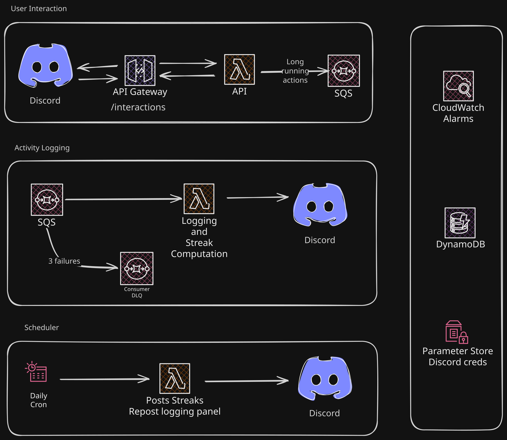

# Spotter

> A serverless Discord bot for tracking daily fitness activity, streaks, and server leaderboards.

[](https://github.com/kumarajith/Spotter/actions/workflows/ci.yml)
[](https://github.com/kumarajith/Spotter/actions/workflows/deploy.yml)


Members log workouts by clicking buttons on a daily panel. Spotter tracks consecutive-day streaks, resets when activity lapses, and posts a leaderboard. The entire backend runs on AWS Lambda — zero idle compute, scales to zero when unused.

---

## Features

- **One-click activity logging** — button panel posted daily with configurable activity types
- **Streak tracking** — per-user consecutive-day streaks; up to 5 rest-only days before a break
- **Milestone celebrations** — in-channel messages at 7, 14, 30, 50, and 100-day milestones
- **30-day heatmap** — visual grid of active vs rest days per user via `/streak`
- **Leaderboard** — current and all-time best streaks via `/leaderboard`
- **Custom activities** — server admins can add and remove activity types
- **Backfill** — log a missed past date and have the streak recomputed correctly
- **Daily automation** — panel reposts at 8 AM UTC with an active-streak summary

---

## Architecture



> The diagram predates v4: where it shows DynamoDB, the database is now Aurora DSQL.

### Key design decisions

| Decision                                 | Rationale                                                                                                      |
| ---------------------------------------- | -------------------------------------------------------------------------------------------------------------- |
| Webhook interactions over Gateway        | Serverless-native — no idle process, scales to zero                                                            |
| Aurora DSQL (serverless Postgres)        | Relational queries for streaks and stats; no VPC, never pauses, IAM auth — no database password to store       |
| Streaks derived on read                  | Logs are the only source of truth. One SQL view (`streak_runs`) computes streaks; nothing to keep in sync      |
| EventBridge Scheduler (not Rules)        | Native timezone support, per-schedule DLQ, flexible invocation windows                                         |
| Deploy-time secrets via SSM SecureString | CloudFormation dynamic references resolve at deploy — zero runtime latency, no IAM grants for SSM:GetParameter |
| esbuild single-file bundles              | Tree-shaken ~760KB vs ~40MB node_modules — eliminates cold start from module resolution                        |

---

## Tech Stack

| Layer     | Technology                                                                              |
| --------- | --------------------------------------------------------------------------------------- |
| Runtime   | Node.js 24, TypeScript                                                                  |
| Bundler   | esbuild                                                                                 |
| Cloud     | AWS Lambda, API Gateway (HTTP API v2), Aurora DSQL, EventBridge Scheduler, SSM, CloudWatch |
| Database  | PostgreSQL-compatible SQL via `pg` + the Aurora DSQL connector (IAM auth)               |
| IaC       | AWS CDK v2 (TypeScript)                                                                 |
| CI/CD     | GitHub Actions + OIDC (no stored AWS credentials)                                       |
| Local dev | PGlite — Postgres running inside the Node process, no Docker                            |

---

## Getting Started

### Prerequisites

- Node.js 24+
- A Discord application ([Developer Portal](https://discord.com/developers/applications))

### 1. Install dependencies

```bash
npm install
```

### 2. Configure environment

```bash
cp .env.example .env
```

Edit `.env` with your Discord credentials from the Developer Portal:

```env
DISCORD_BOT_TOKEN=
DISCORD_APPLICATION_ID=
DISCORD_PUBLIC_KEY=
```

### 3. Start local environment

```bash
npm run local
```

This creates the local database (PGlite, stored in `.pglite/`), applies the migrations, then runs the API dev server. Nothing local talks to AWS. Delete `.pglite/` to start from an empty database.

```
Dev server listening on :3000
```

**Subsequent runs:**

```bash
npm run dev
```

### 4. Register slash commands

```bash
npm run commands:register
```

Set `DISCORD_GUILD_ID` in `.env` for instant guild-scoped registration during development. Leave it unset for global registration (takes up to 1 hour to propagate).

### 5. Expose local server to Discord

Discord must be able to reach your local endpoint to send interactions:

```bash
ngrok http 3000
```

Set the resulting HTTPS URL + `/interactions` as the **Interactions Endpoint URL** in your Discord application settings.

---

## Discord Commands

| Command                       | Description                                            |
| ----------------------------- | ------------------------------------------------------ |
| `/setup`                      | Post the activity tracker panel in the current channel |
| `/addactivity <name> <emoji>` | Add a custom activity for this server                  |
| `/removeactivity <name>`      | Remove a custom activity (with autocomplete)           |
| `/streak [user]`              | Streak stats and 30-day activity heatmap               |
| `/leaderboard`                | Top 10 current streaks and all-time bests              |
| `/backfill <date> <activity>` | Log a past date and recompute the streak               |

---

## Deployment

### One-time setup

**1. Bootstrap CDK** in your AWS account:

```bash
cd infra && npx cdk bootstrap aws://<account-id>/ap-south-1
```

**2. Create the Discord SSM parameters:**

```bash
aws ssm put-parameter --name "/spotter/dev/discord-bot-token" --type SecureString --value "..."
aws ssm put-parameter --name "/spotter/dev/discord-public-key" --type SecureString --value "..."
aws ssm put-parameter --name "/spotter/dev/discord-application-id" --type SecureString --value "..."
```

**3. Set up GitHub Actions OIDC** (one-time, no stored credentials):

Create an IAM OIDC identity provider for `token.actions.githubusercontent.com`, then create an IAM role `GitHubActionsRole` with CDK deploy permissions and a trust policy scoped to this repository. Add the role ARN as a GitHub secret: `AWS_ROLE_ARN`.

**4. Alarm emails (optional):** add a GitHub secret `ALARM_EMAIL`. The prod deploy subscribes that address to the alarm topic; AWS then sends a confirmation email, and nothing is delivered until its link is clicked. For a manual deploy, append `-- -c alarmEmail=you@example.com` to the `infra:deploy:*` command.

### Deploy

```bash
# Dev
npm run infra:deploy:dev

# Prod (via GitHub Actions — requires manual approval in GitHub environment "prod")
git push origin main
```

### CI/CD pipeline

| Trigger                | Action                                                 |
| ---------------------- | ------------------------------------------------------ |
| Pull request to `main` | Lint → Test → Build → CDK synth                        |
| Merge to `main`        | Deploy dev (automatic) → Deploy prod (manual approval) |

---

## Project Structure

```
├── src/
│   ├── lambda.ts                       # API Lambda entry point (plain handler)
│   ├── db/                             # Connection wrapper, migration runner, migrations (schema + streak view)
│   ├── discord/                        # Interaction handler, command routing
│   ├── activity/                       # Activity CRUD (/addactivity, /removeactivity)
│   ├── tracking/                       # Log repository, streak repository (reads the streak_runs view)
│   ├── panel/                          # Panel builder, poster, channel repository
│   ├── scheduler/                      # Daily task service (streak summary, panel repost)
│   ├── handlers/
│   │   ├── scheduler.ts                # Scheduler Lambda entry point
│   │   └── data-ops.ts                 # migrate (every deploy) + cutover functions
│   ├── legacy/                         # Temporary: DynamoDB code, write mirror, import, verify
│   └── common/
│       ├── config/                     # Discord credentials from env vars
│       ├── dates.ts                    # UTC day helpers
│       ├── retry.ts                    # Retry utility with exponential backoff
│       └── types/                      # models.ts
├── infra/
│   ├── bin/infra.ts
│   └── lib/
│       ├── spotter-stack.ts
│       └── constructs/
│           ├── api.ts                  # API Lambda + API Gateway
│           ├── database.ts             # Aurora DSQL cluster (+ the pre-v4 DynamoDB table)
│           ├── data-ops.ts             # Migration/cutover Lambdas + deploy-time triggers
│           ├── scheduler.ts            # Scheduler Lambda + EventBridge Schedule
│           ├── monitoring.ts           # CloudWatch alarms
│           └── notifications.ts       # SNS alarm topic + email
├── scripts/
│   ├── register-commands.ts            # Slash command registration
│   ├── setup-local.ts                  # Creates/migrates the local database
│   ├── dev-server.ts                   # Local API dev server
│   └── verify.ts                       # Cutover check (npm run verify)
├── esbuild.config.mjs
└── .github/workflows/
    ├── ci.yml
    └── deploy.yml
```

---

## Development

### Commands

| Command                     | Description                                   |
| --------------------------- | --------------------------------------------- |
| `npm run local`             | Create/migrate the local database, run app    |
| `npm run dev`               | Start API dev server                          |
| `npm run build`             | esbuild bundle to dist/                       |
| `npm run lint`              | ESLint with auto-fix                          |
| `npm run test`              | Unit + database tests (in-process Postgres)   |
| `npm run commands:register` | Register slash commands with Discord          |
| `npm run verify -- --env dev` | Cutover check: compare DynamoDB and DSQL    |
| `npm run infra:synth`       | Synthesize CloudFormation template            |
| `npm run infra:diff:dev`    | Diff against deployed dev stack               |

### Testing

```bash
npm test                  # App: unit tests + SQL tests against in-process Postgres (PGlite)
cd infra && npm test      # CDK template assertions (run `npm run build` first)
```

137 test cases (109 app, 28 infrastructure) covering:

| Area                 | What's tested                                                                          |
| -------------------- | -------------------------------------------------------------------------------------- |
| Streak rule          | The `streak_runs` view: gaps, rest-day limit, backfill, plus 200 random histories checked against a reference implementation |
| Repositories         | Logs, activities (soft delete / revive), channels, migrations — on real SQL            |
| Discord interactions | Command routing, button clicks, autocomplete, validation, error paths                  |
| Cutover              | DynamoDB mirror, import (idempotent, batched), verify report                           |
| CDK infrastructure   | DSQL cluster, deploy-trigger ordering, Lambda config, CloudWatch alarms, API Gateway   |

The database tests need nothing installed. To run the same suite against a real Aurora DSQL cluster (for example the dev cluster), set `TEST_DSQL_ENDPOINT` to its endpoint and have AWS credentials available.

### Data model

```
activities        (guild_id, name)                               display_name, emoji, is_default, removed_at
activity_logs     (guild_id, user_id, log_date, activity_name)   logged_at
tracked_channels  (guild_id, channel_id)                         last_panel_message_id
streak_runs       VIEW over activity_logs — one row per streak:  guild_id, user_id, start_date, end_date, length
```

Primary keys are in parentheses; every query is a primary-key prefix scan, so there are no secondary indexes.

**Streak rule.** A day counts if anything was logged on it. A run of five or more rest-only days breaks the streak and counts for nothing; shorter rest runs count. The current streak is the run that reaches today or yesterday (UTC). Streaks are never stored — a missed day ends one without anything being written, and `/backfill` simply inserts a log.

Schema changes go in `src/db/migrations/` and are applied automatically on every deploy, before the Lambdas receive new code. Aurora DSQL allows one DDL statement per transaction, so every migration statement must be safe to re-run (`IF NOT EXISTS`, `OR REPLACE`).

### v4 cutover (temporary)

v4 moved the data from DynamoDB to Aurora DSQL. Until the DynamoDB table is retired:

- Every write goes to DSQL and is then repeated in DynamoDB (`src/legacy/mirror.ts`), so DynamoDB stays a complete copy.
- Each deploy copies anything missing from DynamoDB into DSQL, before and after the Lambdas switch. The copy only inserts, so it is safe to repeat.
- `npm run verify -- --env prod` re-runs the copy, compares both stores row by row, and lists users whose derived streak differs from the one stored before v4.
- To roll back: invoke `spotter-<env>-recompute-legacy-streaks` once, then revert the v4 merge.

---

## Roadmap

- [x] Core bot functionality (slash commands, activity logging, streaks)
- [x] Daily automation (streak resets, panel reposts via EventBridge Scheduler)
- [x] CI/CD with GitHub Actions + OIDC
- [x] Unit tests (137 tests across app and infrastructure)
- [x] CloudWatch alarm alerting via SNS email
- [x] Relational data layer on Aurora DSQL, streaks derived from logs (v4)
- [ ] Retire the DynamoDB table and the write mirror once v4 is confirmed
- [ ] **Observability** — structured JSON logging, correlation IDs across Lambda invocations, CloudWatch Logs Insights or Sentry integration
- [ ] **Dashboard** — CloudWatch dashboard or Grafana for key metrics (latency, error rates, streak activity)

---

## License

MIT
